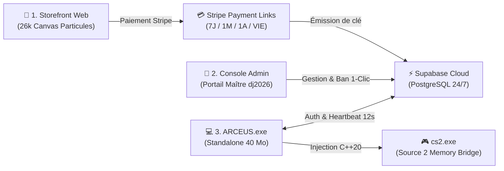

# ARCEUS // CS2 KERNEL SKIN & INVENTORY LOADER

<div align="center">

```
   █████╗ ██████╗  ██████╗███████╗██╗   ██╗███████╗
  ██╔══██╗██╔══██╗██╔════╝██╔════╝██║   ██║██╔════╝
  ███████║██████╔╝██║     █████╗  ██║   ██║███████╗
  ██╔══██║██╔══██╗██║     ██╔══╝  ██║   ██║╚════██║
  ██║  ██║██║  ██║╚██████╗███████╗╚██████╔╝███████║
  ╚═╝  ╚═╝╚═╝  ╚═╝ ╚═════╝╚══════╝ ╚═════╝ ╚══════╝
```

**Suite logicielle complète de personnalisation d'inventaire CS2 (Source 2 Engine)**  
*Architecture hybride C++20 Natif, Moteur Python 3.14, Cloud Supabase, Storefront Stripe & Dashboard Administrateur.*

---

[](https://isocpp.org/)
[](https://python.org/)
[](https://developer.mozilla.org/)
[](https://supabase.com/)
[](https://stripe.com/)
[](https://microsoft.com/)

</div>

---

## 📌 Présentation de l'Écosystème

ARCEUS est une solution tout-en-un divisée en **trois piliers indépendants** et interconnectés :



1. **Le Site Vitrine & Boutique (`2_SITE_BOUTIQUE/`)** : Expérience visuelle haut de gamme avec animation de 26 000 particules morphing sur le curseur, présentation du cheat et tunnel d'achat direct sans intermédiaire via Stripe.
2. **Le Panneau Administrateur (`3_SITE_ADMIN/`)** : Tableau de bord privé protégé par mot de passe maître, connecté en direct à Supabase pour générer des licences en 1 clic, suivre les joueurs actifs en jeu et bannir des clés à distance.
3. **Le Client Autonome Joueur (`1_DISTRIBUTION_JOUEUR/`)** : Un exécutable unique compilé (`ARCEUS.exe`, 40 Mo) distribué aux joueurs, sans installation requise, intégrant le pont mémoire natif C++20 et un watchdog anti-partage avec kill-switch CS2.

---

## 💻 Langages & Stack Technologique

Le projet est développé sur une architecture polyglotte rigoureusement découplée :

| Composant | Langages / Technologies | Rôle dans l'Architecture |
| :--- | :--- | :--- |
| **Pont Mémoire CS2** | **C++20**, MSVC v143, CMake, Win32 API | Injection mémoire, résolution dynamique des offsets Source 2 (`C_EconItemView`), hooking d'entités in-game. |
| **Moteur Runtime & Watchdog** | **Python 3.14**, PyInstaller 6.17, `ctypes` | Orchestration locale, écoute des raccourcis clavier (`INSERT`), serveur HTTP IPC, thread watchdog d'auto-kill. |
| **Sécurité & Licences** | **Python**, SHA-256 HMAC, SQLite3, Registry | Empreinte matérielle HWID (MachineGuid + UUID BIOS), vérification cryptographique hors-ligne et en ligne. |
| **Base de Données Cloud** | **PostgreSQL**, **Supabase REST API** | Synchronisation en temps réel 24h/24, gestion des sessions concurrentes, révocation immédiate sans serveur dédié. |
| **Interface Graphique (IHM)** | **HTML5**, **CSS3**, **JavaScript (ES6+)**, Webview | Rendu matériel sans bordures, thème cyberpunk sombre, badge HUD avec chrono dynamique en temps réel. |
| **Boutique Publicitaire** | **HTML5 Canvas 2D**, WebGL, Stripe Checkout | Moteur physique de 26 000 particules morphing, intégration des formules Stripe sécurisées. |

---

## 📂 Structure du Répertoire

```
SKIN LOADER/
├── 1_DISTRIBUTION_JOUEUR/         # 📦 PAQUET PRÊT POUR LES JOUEURS
│   ├── ARCEUS.exe                 # Exécutable autonome compilé (40 Mo, zéro console)
│   └── LISEZ_MOI.txt              # Guide d'utilisation joueur (touche INSERT in-game)
│
├── 2_SITE_BOUTIQUE/               # 🛒 SITE WEB VITRINE (PRÊT POUR NETLIFY / VERCEL)
│   ├── index.html                 # Storefront 26 000 particules & cartes Stripe
│   ├── arx-config.js              # Configuration et télémétrie visuelle
│   ├── GUIDE_PUBLICATION_SITE.txt # Instructions de déploiement en 30 secondes
│   └── [assets visuels]           # Logos, spritesheets, icônes et arrière-plans
│
├── 3_SITE_ADMIN/                  # 👑 CONSOLE D'ADMINISTRATION SECRÈTE
│   ├── index.html                 # Dashboard maître (mot de passe : dj2026)
│   ├── admin.html                 # Alias d'accès direct
│   ├── GUIDE_ADMIN.txt            # Guide d'exploitation et de révocation
│   └── [assets]                   # Icônes et identité visuelle
│
├── native/                        # ⚡ CODE SOURCE C++ DU PONT CS2
│   ├── dllmain.cpp                # DLL de synchronisation mémoire et injection d'items
│   ├── injector.cpp               # Injecteur CreateRemoteThread x64
│   ├── offsets.hpp                # Table des schémas Source 2 / C_EconItemView
│   ├── mesa_bridge.dll            # Binaire compilé x64 Release
│   └── mesa_injector.exe          # Binaire injecteur compilé x64 Release
│
├── main.py                        # Orchestrateur backend Python & serveur IPC local
├── ui_template.py                 # Interface graphique ARCEUS (thème Dark HUD)
├── license_manager.py             # Moteur de licences (HWID, Supabase & SHA-256)
├── db.py                          # Gestionnaire SQLite du catalogue de skins & stickers
├── econ_defs.py                   # Définitions Protobuf Valve & conformité CSFloat
├── arceus_server.py               # Serveur d'authentification Python alternatif
├── ARCEUS.spec                    # Fichier de build PyInstaller autonome
├── Dockerfile & Procfile          # Déploiement cloud Docker (Railway / Render)
└── PUSH_GITHUB.bat                # Script automatisé de push vers GitHub
```

---

## 🛡️ Sécurité & Système de Licences

### 1. Empreinte Matérielle (HWID Locking)
À chaque tentative de connexion, l'exécutable génère un hash SHA-256 combinant :
* Le `MachineGuid` unique du registre Windows (`HKLM\SOFTWARE\Microsoft\Cryptography`).
* L'UUID physique de la carte mère / BIOS interrogé via l'API système.
* L'adresse MAC du contrôleur réseau primaire.

### 2. Verrouillage de Session Concurrente (Anti-Partage)
Une même clé **ne peut pas être utilisée sur deux ordinateurs simultanément**.  
Le client envoie un battement de cœur (*heartbeat*) toutes les 12 secondes. Si une deuxième machine tente d'ouvrir une session avec la même clé, elle est refoulée immédiatement :
> `[409 CONCURRENT_SESSION_LOCKED] : CETTE CLÉ EST DÉJÀ EN COURS D'UTILISATION SUR UN AUTRE ORDINATEUR`

### 3. Kill-Switch Automatique & Révocation à Distance
* **Fin de temps (`00s`)** : Quand le compte à rebours de la licence arrive à zéro, le thread de sécurité exécute immédiatement l'arrêt forcé de `cs2.exe` et d'`ARCEUS.exe`.
* **Ban en direct** : Dès que l'administrateur clique sur **« Bannir »** sur son tableau de bord, Supabase met à jour `is_revoked = true`. Au battement de cœur suivant (< 12s), le jeu du joueur ciblé est instantanément fermé.

---

## 🚀 Déploiement & Publication

### 1. Mettre en ligne la Boutique (`2_SITE_BOUTIQUE`)
1. Rendez-vous sur **[Netlify Drop](https://app.netlify.com/drop)** (gratuit, sans compte obligatoire).
2. Glissez-déposez l'intégralité du dossier `2_SITE_BOUTIQUE`.
3. Votre site est instantanément en ligne en HTTPS avec vos liens de paiement Stripe.

### 2. Accéder à la Console Admin (`3_SITE_ADMIN`)
* **En local** : Double-cliquez simplement sur `3_SITE_ADMIN/index.html`.
* **En ligne** : Vous pouvez également glisser le dossier `3_SITE_ADMIN` sur Netlify ou Vercel pour administrer vos licences depuis votre smartphone.
* **Mot de passe maître** : `dj2026`

### 3. Distribuer le Client aux Joueurs (`1_DISTRIBUTION_JOUEUR`)
* Transmettez simplement le fichier `ARCEUS.exe` situé dans `1_DISTRIBUTION_JOUEUR`.
* Le joueur lance l'exe, entre la clé d'activation reçue, et appuie sur **`INSERT`** dans CS2 pour afficher son menu.

---

## ⚙️ Compilation depuis les Sources

Pour recompiler l'exécutable autonome depuis le code source :

```powershell
# 1. Installation des dépendances Python
pip install -r requirements.txt

# 2. Compilation du binaire unique avec PyInstaller
python -m PyInstaller --noconfirm ARCEUS.spec
```

Le fichier compilé `ARCEUS.exe` sera généré dans le dossier `dist/`.

---

<div align="center">
<sub>ARCEUS Software // Counter-Strike 2 Memory Modding & Customization Suite</sub>
</div>
